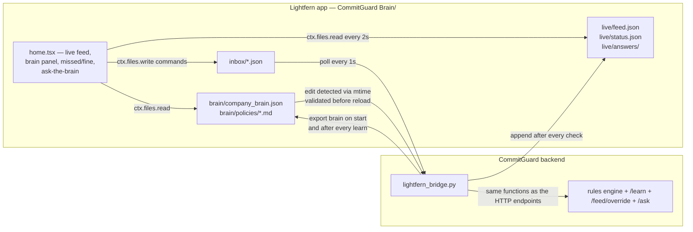

# CommitGuard

CommitGuard watches your team's Slack and stops messages that break company
policy, citing the company brain, and learns new rules when a human
corrects it.

Built for the Lightfern Company Brain Buildathon — Finance/Ops track.

## How it works

```mermaid
flowchart LR
    slack[Slack channel] --> poll[CommitGuard poller]
    poll --> engine[Deterministic rules engine]
    brain[(company brain<br/>company_brain.json)] --> engine
    poll -->|"? / ask: / @bot"| ask[Ask-the-brain]
    brain --> ask
    engine -->|violations + cited evidence| reply[Threaded Block Kit reply]
    ask -->|sourced answer| reply
    engine --> dash[Dashboard · /feed · audit log]
    ask --> dash
    reply -->|human override: "you missed this"| learn[/learn]
    learn -->|learned_rules, enforced immediately| brain
```

## Quickstart

```bash
cp backend/.env.example backend/.env   # Slack tokens optional — no .env = simulated mode
scripts/run_demo.sh                    # API + dashboard on 127.0.0.1:8000
open http://127.0.0.1:8000             # the dashboard
```

Works fully offline with every token unset. Use `127.0.0.1`, not
`localhost` — some Macs resolve `localhost` to IPv6 where uvicorn doesn't
listen.

## Judging criteria → where it lives

| Criterion | What we built | Where |
|---|---|---|
| **Onboarding test** | A new hire asks `? can I give a 20% discount?` in Slack (or `POST /ask`) and gets a plain-English answer that cites the exact brain keys it came from | `POST /ask`, `GET /brain/policies`, Slack question replies in `slack_feed.py` |
| **Structured + unstructured** | Free-text messages checked against the structured brain — contracts, pricing floors, approval limits, trusted sender domains — every violation cites `brain_key`, expected vs found | `rules.py`, `company_brain.json` |
| **Brain and hands** | The brain decides; the hands act: every verify result carries an `actions` plan (`HOLD_PAYMENT`, `ESCALATE`, `REQUEST_APPROVAL`, … with brain-sourced targets), `STAGE_INVOICE` queues payments for Round Treasury, `ESCALATE_FRAUD`, `APPLY_REWRITE_AND_LOG`, and every check lands in an append-only audit trail. AuditTrace parses invoices and reconciles every field against the signed contract — rate/amount overage, IBAN/sort-code/account mismatches (BEC signature), hidden uplift clauses, re-billed invoices, terms drift | `actions.py` `plan_actions`, `POST /execute-action`, `actions` on `/verify-context` + `/feed`, `audit_trace.py` |
| **Learns and updates itself** | "You missed this" on any feed item teaches a `learned_rules` entry; "that's fine" teaches a `learned_exceptions` entry — both enforced by the deterministic engine from the next request. TribalSync goes further: an authoritative decision in the feed ("CFO: from today, terms are Net-45") becomes a pending brain-patch proposal with evidence and predicted impact — a human applies or rejects it (Slack thread `apply`/`reject` or HTTP), and every mutation lands in the brain changelog | `POST /learn`, `POST /feed/{id}/override`, `GET /brain/learned`, `tribal_sync.py`, `brain_store.py`, `GET /brain/proposals`, `GET /brain/changelog` |

Detection is deterministic — regex + dictionary checks against the brain in
under 5ms, fully offline (see `backend/bench.py`). An optional OpenAI layer
polishes wording only; it can never flip a verdict.

## Verify it yourself

```bash
cd backend && uv run python smoke_test.py    # prints ALL PASS
curl -X POST http://127.0.0.1:8000/ask \
  -H 'Content-Type: application/json' \
  -d '{"question": "who approves a £7,000 spend?"}'
```

## Built on Lightfern

The **company brain lives in Lightfern**. `lightfern/CommitGuard Brain/` is a
real Lightfern app (built against `@lightfern/plugin-sdk` v2.4): the brain,
readable policy markdown, and a home view that streams live compliance
results. CommitGuard reads the brain out of that folder and writes back to
it — through files, because Lightfern views run in a sandboxed iframe whose
network is restricted to declared `network_permissions` origins. This app
needs no network at all.



- **What lives in Lightfern** — `brain/company_brain.json` (generated by
  `scripts/lightfern_export.py`, never hand-edited), one readable
  `brain/policies/*.md` per policy, `live/` feed + status + answers, and
  `code/` (manifest `2.4`, `src/home.tsx` live dashboard, `src/policy.tsx`
  markdown view). Edit the brain inside Lightfern and the backend re-imports
  it — bad JSON is rejected and logged to `live/status.json`.
- **The file bridge** — `backend/lightfern_bridge.py`, enabled only by
  `LIGHTFERN_APP_DIR`. It exports the brain, mirrors every check into
  `live/feed.json` (last 100, atomic tmp+rename), polls `inbox/` every second
  and applies `learn`/`override`/`ask` commands through the exact functions
  the HTTP endpoints use, then re-exports so learned rules show up in
  Lightfern. Unset = backend behaves exactly as today. Status:
  `GET /lightfern/status`.
- **Install** —
  `scripts/lightfern_install.sh ~/Library/Application\ Support/Lightfern/library`
  copies the app into your Lightfern library and prints the
  `LIGHTFERN_APP_DIR=` line for `backend/.env`. Restart the backend; the
  home view's badge flips from `SIMULATED` to `LIVE`.

> Honest note: this machine can't run Lightfern, so the app was validated
> against the SDK itself — manifest parsed by the SDK's `safeParseManifest`,
> `tsc --noEmit` against the SDK's `lightfern:host` types, and a vitest that
> renders `home.tsx` against a fake ctx and clicks **Missed** (see
> `lightfern/dev/`). The backend bridge is covered end-to-end by
> `backend/test_lightfern_bridge.py`, and the whole integration against a
> real server by `scripts/lightfern_live_check.py` — it spins up uvicorn on
> 127.0.0.1:8008 with a temp app copy and asserts the check→feed, heartbeat,
> learn, override, ask, brain-edit, corrupt-brain and restart flows (prints
> `LIGHTFERN READY`). The home view's header shows **CONNECTED** whenever
> `live/status.json`'s `heartbeat_ts` is fresh (~1s writes) and **STALE**
> when it isn't. All company data in the app folder is **sample data** for
> the demo.

## Repo map

| Path | Owner | What |
|---|---|---|
| `backend/rules.py` `actions.py` `company_brain.json` `scenarios.json` `smoke_test.py` `bench.py` `seed_audit.py` `onboarding.py` | Darsh | Deterministic engine + action handlers + brain data + tests |
| `backend/main.py` `llm_enrich.py` `slack_feed.py` `lightfern_bridge.py` `brain_store.py` `tribal_sync.py` `audit_trace.py` `chaser.py` `scripts/` | Riyansh | FastAPI orchestration, optional OpenAI stage (fail-open), Slack feed + questions, Lightfern file bridge, atomic brain writer (single-writer + changelog + on-change hooks), TribalSync decision→patch proposals, AuditTrace invoice reconciliation, invoice chaser (receivables ageing + chase drafts), demo scripts |
| `lightfern/` | Riyansh | `CommitGuard Brain/` Lightfern app (manifest + home/policy views + brain data) and `dev/` proof harness |
| `demo/` `plugin/` `pitch/` | Pranali | All frontend: demo UI, Inspector, simulator/plugin, pitch assets |
| `team/` | all | Per-person phase plans + agent prompts (`team/riyansh`, `team/darsh`, `team/pranali`) |
| `TOMORROW.md` | shared | **Day-of runbook — the only doc you need open** |
| `CONTRACT.md` | shared | API contract — read before coding |
| `E2E.md` | shared | Live-Slack demo runbook |
| `TEAM_PLAN.md` | shared | Timeline, merge checkpoints, stretch queue |
| `PLAYBOOK.md` | shared | Strategy, judges, narrative |
