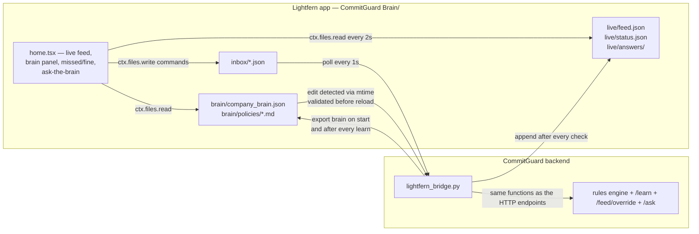

# CommitGuard

CommitGuard is a finance brain built on Lightfern: it catches spend, payment
and pricing commitments that break policy in Slack, chases overdue invoices
with draft-only reminders, answers policy questions, and learns new rules
from the team.

Built for the Lightfern Company Brain Buildathon — Finance/Ops track.

## What it does

- **Guard** — every channel message runs through a deterministic rules engine
  (regex + dictionary checks against the company brain, no LLM in the verdict
  path). Violations get a threaded Block Kit reply that cites the exact brain
  keys — expected vs found — plus an action plan (`HOLD_PAYMENT`, `ESCALATE`,
  `REQUEST_APPROVAL`, `STAGE_INVOICE`, …). Everything lands in an append-only
  audit log.
- **Chase** — receivables ageing lives in the brain; `chase INV-1041` drafts a
  tone-laddered payment reminder with cites to invoice terms. Drafts only —
  nothing is ever sent. Paid/promise chatter in the channel updates invoice
  state.
- **Ask** — `? what's my spend limit` (or `POST /ask`) answers policy questions
  in plain English, citing the brain keys the answer came from.
- **Learn** — "MISSED SOMETHING" (`missed:` reply) teaches a rule the engine
  enforces from the next request; "THIS WAS FINE" (`fine:` reply) teaches a
  scoped exception. Learned rules are written back into the Lightfern brain.

```mermaid
flowchart LR
    slack[Slack channel] --> poll[CommitGuard poller]
    poll --> engine[Deterministic rules engine]
    brain[(company brain<br/>company_brain.json)] --> engine
    poll -->|"? / ask: / @bot"| ask[Ask-the-brain]
    brain --> ask
    engine -->|violations + cited evidence| reply[Threaded Block Kit reply]
    ask -->|sourced answer| reply
    engine --> dash[Dashboard · /feed · audit log]
    ask --> dash
    reply -->|human override: "you missed this"| learn[/learn]
    learn -->|learned_rules, enforced immediately| brain
```

## Built on Lightfern

The **company brain lives in Lightfern**. `lightfern/CommitGuard Brain/` is a
real Lightfern app (built against `@lightfern/plugin-sdk` v2.4): the brain,
readable policy markdown, and a home view that streams live compliance
results. CommitGuard reads the brain out of that folder and writes back to
it — through files, because Lightfern views run in a sandboxed iframe whose
network is restricted to declared `network_permissions` origins. This app
needs no network at all.



- **What lives in Lightfern** — `brain/company_brain.json` (generated by
  `scripts/lightfern_export.py`, never hand-edited), one readable
  `brain/policies/*.md` per policy, `live/` feed + status + answers, and
  `code/` (manifest `2.4`, `src/home.tsx` live dashboard, `src/policy.tsx`
  markdown view). Edit the brain inside Lightfern and the backend re-imports
  it — bad JSON is rejected and logged to `live/status.json`.
- **The file bridge** — `backend/lightfern_bridge.py`, enabled only by
  `LIGHTFERN_APP_DIR`. It exports the brain, mirrors every check into
  `live/feed.json` (last 100, atomic tmp+rename), polls `inbox/` every second
  and applies `learn`/`override`/`ask` commands through the exact functions
  the HTTP endpoints use, then re-exports so learned rules show up in
  Lightfern. Unset = backend behaves exactly as without the bridge. Status:
  `GET /lightfern/status`.
- **Install** —
  `scripts/lightfern_install.sh ~/Library/Application\ Support/Lightfern/library`
  copies the app into your Lightfern library and prints the
  `LIGHTFERN_APP_DIR=` line for `backend/.env`. Restart the backend; the
  home view's badge flips from `SIMULATED` to `LIVE`.

> The app is validated against the SDK itself — manifest parsed by
> `safeParseManifest`, `tsc --noEmit` on `lightfern:host` types, a vitest that
> renders `home.tsx` against a fake ctx (`lightfern/dev/`), plus end-to-end
> coverage in `backend/test_lightfern_bridge.py` and
> `scripts/lightfern_live_check.py` against a real server (prints
> `LIGHTFERN READY`). All company data in the app folder is **sample data**.

## Quick start

```bash
cd backend && uv venv --python 3.12 && uv pip install -r requirements.txt
cp .env.example .env                        # all keys optional — see names below
uv run uvicorn main:app --host 127.0.0.1 --port 8001
open http://127.0.0.1:8001                  # the dashboard
```

`backend/.env` keys (all optional — with none set, the feed runs in simulated
mode and every feature still works offline):

| Key | Effect |
|---|---|
| `SLACK_BOT_TOKEN` + `SLACK_CHANNEL_ID` | both set → live Slack feed |
| `SLACK_REPLY` | `1` = post threaded warnings + reactions; `0`/unset = monitor only |
| `OPENAI_API_KEY` | optional wording polish — can never flip a verdict |
| `LIGHTFERN_APP_DIR` | enables the Lightfern file bridge |

Use `127.0.0.1`, not `localhost` — some Macs resolve `localhost` to IPv6
where uvicorn doesn't listen.

## Demo commands

In the Slack channel (or via the dashboard):

| Command | What happens |
|---|---|
| `? who owes us money` | ask-the-brain answers from `finance.invoices` — open + overdue receivables |
| `chase INV-1041` | drafts a tone-laddered chase for the invoice — draft only, cites terms |
| `? what's my spend limit` | answers with the approval tiers from the brain |

Any normal message gets verified — paste an invoice with fresh bank details
to see a CRITICAL `PAYMENT_REDIRECTION` catch.

## Team

| Name | Role |
|---|---|
| Riyansh | CEO |
| Darsh | CFO |
| Pranali | Team lead |

## Judging criteria → where it lives

| Criterion | What we built | Where |
|---|---|---|
| **Onboarding test** | A new hire asks `? can I give a 20% discount?` in Slack (or `POST /ask`) and gets a plain-English answer that cites the exact brain keys it came from | `POST /ask`, `GET /brain/policies`, Slack question replies in `slack_feed.py` |
| **Structured + unstructured** | Free-text messages checked against the structured brain — contracts, pricing floors, approval limits, trusted sender domains — every violation cites `brain_key`, expected vs found | `rules.py`, `company_brain.json` |
| **Brain and hands** | The brain decides; the hands act: every verify result carries an `actions` plan (`HOLD_PAYMENT`, `ESCALATE`, `REQUEST_APPROVAL`, `VERIFY_VENDOR`, `REQUEST_CREDIT_NOTE`, `CHASE_INVOICE` … with brain-sourced targets), `STAGE_INVOICE` queues payments for Round Treasury, `ESCALATE_FRAUD`, `APPLY_REWRITE_AND_LOG`, and every check lands in an append-only audit trail. AuditTrace parses invoices and reconciles every field against the signed contract — rate/amount overage, IBAN/sort-code/account mismatches (the BEC signature), hidden uplift clauses, re-billed invoices, terms drift. The chaser ages receivables and drafts tone-laddered chase notes | `actions.py` `plan_actions`, `POST /execute-action`, `actions` on `/verify-context` + `/feed`, `audit_trace.py`, `chaser.py` |
| **Learns and updates itself** | "You missed this" on any feed item teaches a `learned_rules` entry; "that's fine" teaches a `learned_exceptions` entry — both enforced by the deterministic engine from the next request, in Slack (`missed:`/`fine` thread replies) or over HTTP. TribalSync goes further: an authoritative decision in the feed ("CFO: from today, terms are Net-45") becomes a pending brain-patch proposal with evidence and predicted impact — a human applies or rejects it (Slack thread `apply`/`reject` or HTTP) and every mutation lands in the brain changelog | `POST /learn`, `POST /feed/{id}/override`, `GET /brain/learned`, `tribal_sync.py`, `brain_store.py`, `GET /brain/proposals`, `GET /brain/changelog` |

Detection is deterministic — regex + dictionary checks against the brain in
under 5ms, fully offline (see `backend/bench.py`). An optional OpenAI layer
polishes wording only; it can never flip a verdict.

## Verify it yourself

```bash
cd backend && uv run python smoke_test.py    # prints ALL PASS
curl -X POST http://127.0.0.1:8001/ask \
  -H 'Content-Type: application/json' \
  -d '{"question": "who approves a £7,000 spend?"}'
```

## Repo map

| Path | Owner | What |
|---|---|---|
| `backend/rules.py` `actions.py` `company_brain.json` `scenarios.json` `smoke_test.py` `bench.py` `seed_audit.py` `onboarding.py` | Darsh | Deterministic engine + action handlers + brain data + tests |
| `backend/main.py` `llm_enrich.py` `slack_feed.py` `lightfern_bridge.py` `brain_store.py` `tribal_sync.py` `audit_trace.py` `chaser.py` `scripts/` | Riyansh | FastAPI orchestration, optional OpenAI stage (fail-open), Slack feed + questions, Lightfern file bridge, atomic brain writer (single-writer + changelog + on-change hooks), TribalSync decision→patch proposals, AuditTrace invoice reconciliation, invoice chaser (receivables ageing + chase drafts), demo scripts |
| `lightfern/` | Riyansh | `CommitGuard Brain/` Lightfern app (manifest + home/policy views + brain data) and `dev/` proof harness |
| `demo/` `plugin/` `pitch/` | Pranali | All frontend: demo UI, Inspector, simulator/plugin, pitch assets |
| `team/` | all | Per-person phase plans + agent prompts (`team/riyansh`, `team/darsh`, `team/pranali`) |
| `TOMORROW.md` | shared | **Day-of runbook — the only doc you need open** |
| `CONTRACT.md` | shared | API contract — read before coding |
| `E2E.md` | shared | Live-Slack demo runbook |
| `TEAM_PLAN.md` | shared | Timeline, merge checkpoints, stretch queue |
| `PLAYBOOK.md` | shared | Strategy, judges, narrative |
